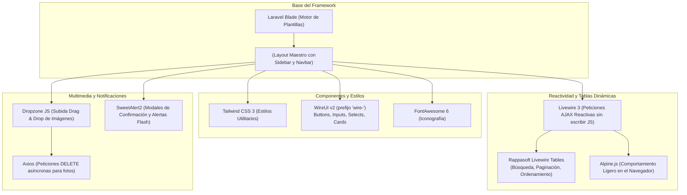
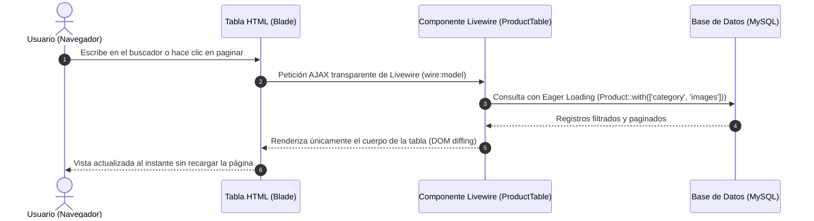
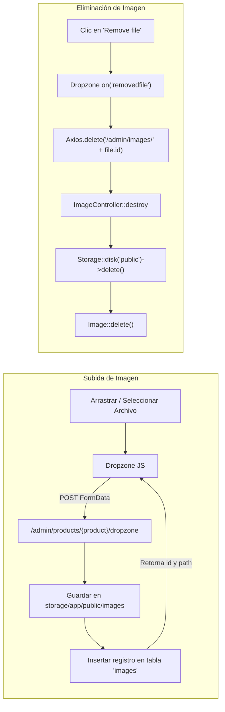

# 🎨 Guía de Arquitectura Frontend e Interfaz (UI/UX)

Esta guía documenta la arquitectura de interfaz de usuario del **Sistema de Inventario**, basada en el stack **TALL** (Tailwind CSS, Alpine.js, Laravel Blade, Livewire 3), complementada con **WireUI v2**, **Rappasoft Livewire Tables**, **Dropzone JS** y **SweetAlert2**.

---

## 🛠️ 1. Diagrama del Stack Tecnológico Frontend



---

## 🏛️ 2. Jerarquía de Componentes y Vistas Blade

Cada módulo administrativo (`categories`, `products`, `customers`, `suppliers`, `warehouses`) sigue la misma estructura estandarizada en [resources/views/admin/](file:///c:/wamp64/www/laravel/inventatirio/resources/views/admin):

```text
resources/views/admin/
├── categories/          # Listado, Creación, Edición y Botones de acción
├── products/            # Incluye Dropzone para fotos y vistas CRUD
├── customers/           # Incluye selector de tipo de documento
├── suppliers/           # Incluye selector de tipo de documento
└── warehouses/          # Gestión de almacenes físicos
```

### A. Anatomía de una Vista Index con Datatable Livewire
```blade
<x-admin-layout 
    title="Productos | DevStore"
    :breadcrumb="[ 
        ['name' => 'Dashboard', 'href' => route('admin.dashboard')],
        ['name' => 'Productos'],
    ]"> 

    {{-- Botón de acción en la esquina superior derecha --}}
    <x-slot name="action">
        <x-wire-button href="{{ route('admin.products.create') }}" color="blue">
            <i class="fas fa-plus mr-1"></i>
            Nuevo Producto
        </x-wire-button>
    </x-slot>

    {{-- Inclusión del Datatable reactivo de Livewire --}}
    @livewire('admin.datatables.product-table')

    {{-- Script de confirmación SweetAlert con delegación de eventos --}}
    @push('js')
    <script>
        document.addEventListener('submit', function(e) {
            const form = e.target.closest('.delete-form');
            if (!form) return;

            e.preventDefault();
            Swal.fire({
                title: "¿Seguro?",
                text: "¡No podrás revertir esta acción!",
                icon: "warning",
                showCancelButton: true,
                confirmButtonColor: "#3085d6",
                cancelButtonColor: "#d33",
                confirmButtonText: "¡Sí, eliminar!",
                cancelButtonText: "Cancelar",
            }).then((result) => {
                if (result.isConfirmed) {
                    form.submit();
                }
            });
        });
    </script>
    @endpush
</x-admin-layout>
```

---

## 🔄 3. Flujo de Trabajo en las Tablas Reactivas (Livewire Tables)



---

## 📸 4. Arquitectura de Carga Multimedia (Dropzone + Axios)

El módulo de Productos cuenta con subida asíncrona de fotografías en [resources/views/admin/products/edit.blade.php](file:///c:/wamp64/www/laravel/inventatirio/resources/views/admin/products/edit.blade.php):



### Inicialización de Archivos Existentes (`mockFile`)
Cuando se abre el formulario de edición, las imágenes previamente almacenadas en la base de datos se cargan visualmente en Dropzone:

```javascript
let images = @json($product->images);

images.forEach(function(image) {
    let mockFile = { 
        id: image.id,
        name: image.path.split('/').pop(),
        size: image.size,
    };
    
    // Dibuja la miniatura visual en Dropzone
    myDropzone.displayExistingFile(mockFile, `/storage/${image.path}`);
    myDropzone.emit("complete", mockFile);
    myDropzone.files.push(mockFile);
});
```

---

## 💡 5. Patrones UX y Buenas Prácticas Frontend Implementadas

| Característica | Implementación | Beneficio para el Usuario |
| :--- | :--- | :--- |
| **Delegación de Eventos (`document.addEventListener`)** | Se escucha el evento `submit` a nivel global en lugar de `querySelectorAll('.delete-form')`. | Permite que el modal de confirmación SweetAlert2 funcione siempre, incluso después de cambiar de página o filtrar en la tabla Livewire. |
| **Persistencia de Formularios (`old()`)** | `value="{{ old('name', $product->name) }}"` | Si la validación falla por cualquier motivo, el usuario no pierde los datos que ya escribió. |
| **Componentes Unificados WireUI** | `<x-wire-card>`, `<x-wire-input>`, `<x-wire-native-select>`, `<x-wire-button>` | Diseño limpio, consistente, accesible y con soporte integrado para validación de errores. |
| **Notificaciones Flash Estilizadas** | SweetAlert2 (`session()->flash('swal', [...])`) | Mensajes visuales no invasivos con íconos de éxito o advertencia tras cada acción de guardado o borrado. |
| **Imágenes Optimizadas en Tabla** | `ImageColumn` en [ProductTable.php](file:///c:/wamp64/www/laravel/inventatirio/app/Livewire/Admin/Datatables/ProductTable.php) | Previsualización clara de cada producto con fallback de imagen por defecto. |
