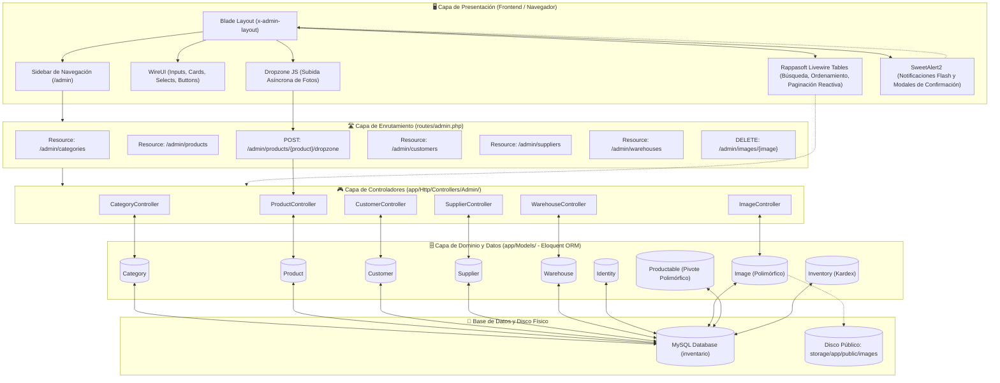
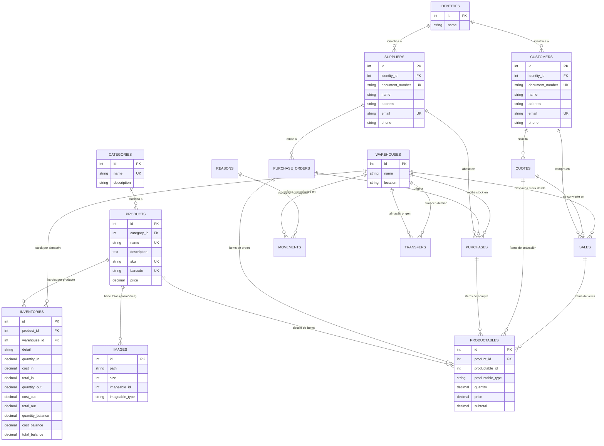
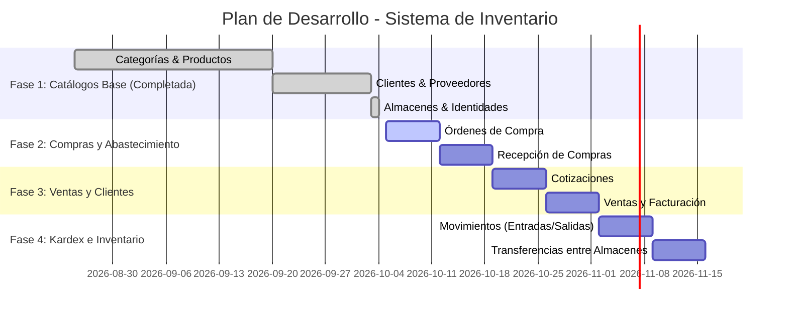

# 📚 Guía de Arquitectura y Desarrollo: Sistema de Inventario (DevStore)

¡Bienvenido/a al registro de arquitectura del **Sistema de Gestión de Inventario**! Este documento detalla la estructura completa del proyecto, cómo interactúan sus capas (MVC, Livewire, Eloquent, Base de Datos), los 5 CRUDs base completados y la hoja de ruta para los módulos de compras, ventas y movimientos de stock.

---

## 🗺️ 1. Mapa de Arquitectura General del Sistema

El proyecto sigue una arquitectura **MVC desacoplada** combinada con componentes reactivos **Livewire 3** para las tablas de datos, **WireUI** para componentes de interfaz, y **Dropzone + Axios** para la gestión multimedia asíncrona:



---

## 📊 2. Modelo de Base de Datos (Diagrama ERD)

El diseño de la base de datos centraliza la trazabilidad comercial y el control de inventario mediante relaciones 1:N y tablas pivote polimórficas.

### A. Diagrama Visual Oficial


### B. Mapa Relacional en Código (Mermaid ERD)



---

## 🗃️ 3. Resumen de Modelos y Relaciones Eloquent

A continuación se muestra el mapa de los modelos implementados en [app/Models/](file:///c:/wamp64/www/laravel/inventatirio/app/Models):

| Modelo | Tabla | Relaciones Definidas | Propósito en el Sistema |
| :--- | :--- | :--- | :--- |
| [`Identity`](file:///c:/wamp64/www/laravel/inventatirio/app/Models/Identity.php) | `identities` | `hasMany(Customer)`, `hasMany(Supplier)` | Tipos de documento oficiales (DNI, Pasaporte, RUC, etc.). |
| [`Category`](file:///c:/wamp64/www/laravel/inventatirio/app/Models/Category.php) | `categories` | `hasMany(Product)` | Clasificación lógica de productos en el catálogo. |
| [`Product`](file:///c:/wamp64/www/laravel/inventatirio/app/Models/Product.php) | `products` | `belongsTo(Category)`, `morphMany(Image)`, `hasMany(Inventory)`, `hasMany(Productable)`, `morphedByMany(PurchaseOrder)`, `morphedByMany(Quote)` | Ítem comercial con control de precio, SKU, barcode e imágenes. |
| [`Customer`](file:///c:/wamp64/www/laravel/inventatirio/app/Models/Customer.php) | `customers` | `belongsTo(Identity)`, `hasMany(Quote)`, `hasMany(Sale)` | Clientes destinatarios de cotizaciones y ventas. |
| [`Supplier`](file:///c:/wamp64/www/laravel/inventatirio/app/Models/Supplier.php) | `suppliers` | `belongsTo(Identity)`, `hasMany(PurchaseOrder)`, `hasMany(Purchase)` | Proveedores emisores de órdenes de compra y compras. |
| [`Warehouse`](file:///c:/wamp64/www/laravel/inventatirio/app/Models/Warehouse.php) | `warehouses` | `hasMany(Inventory)` | Almacenes físicos donde se custodia y distribuye la mercancía. |
| [`Image`](file:///c:/wamp64/www/laravel/inventatirio/app/Models/Image.php) | `images` | `morphTo(imageable)` | Fotos subidas al disco `public` vinculadas polimórficamente a productos. |

---

## 📦 4. Detalle de los 5 Módulos CRUD Completados

Todos los módulos se gestionan desde el panel administrativo con la convención RESTful estándar de Laravel en [routes/admin.php](file:///c:/wamp64/www/laravel/inventatirio/routes/admin.php):

| Módulo | Controlador | Datatable Livewire | Vistas Blade | Reglas de Protección al Eliminar (`destroy`) |
| :--- | :--- | :--- | :--- | :--- |
| **Categorías** | [`CategoryController`](file:///c:/wamp64/www/laravel/inventatirio/app/Http/Controllers/Admin/CategoryController.php) | [`CategoryTable`](file:///c:/wamp64/www/laravel/inventatirio/app/Livewire/Admin/Datatables/CategoryTable.php) | [`resources/views/admin/categories/`](file:///c:/wamp64/www/laravel/inventatirio/resources/views/admin/categories) | Bloquea el borrado si la categoría tiene productos asociados (`$category->products()->exists()`). |
| **Productos** | [`ProductController`](file:///c:/wamp64/www/laravel/inventatirio/app/Http/Controllers/Admin/ProductController.php) | [`ProductTable`](file:///c:/wamp64/www/laravel/inventatirio/app/Livewire/Admin/Datatables/ProductTable.php) | [`resources/views/admin/products/`](file:///c:/wamp64/www/laravel/inventatirio/resources/views/admin/products) | Bloquea si tiene movimientos en inventario (`inventories`) o transacciones (`productables`). Elimina fotos en disco al borrar. |
| **Clientes** | [`CustomerController`](file:///c:/wamp64/www/laravel/inventatirio/app/Http/Controllers/Admin/CustomerController.php) | [`CustomerTable`](file:///c:/wamp64/www/laravel/inventatirio/app/Livewire/Admin/Datatables/CustomerTable.php) | [`resources/views/admin/customers/`](file:///c:/wamp64/www/laravel/inventatirio/resources/views/admin/customers) | Bloquea si el cliente tiene cotizaciones (`quotes`) o ventas (`sales`) registradas. |
| **Proveedores** | [`SupplierController`](file:///c:/wamp64/www/laravel/inventatirio/app/Http/Controllers/Admin/SupplierController.php) | [`SupplierTable`](file:///c:/wamp64/www/laravel/inventatirio/app/Livewire/Admin/Datatables/SupplierTable.php) | [`resources/views/admin/suppliers/`](file:///c:/wamp64/www/laravel/inventatirio/resources/views/admin/suppliers) | Bloquea si el proveedor tiene órdenes de compra (`purchaseOrders`) o compras (`purchases`) activas. |
| **Almacenes** | [`WarehouseController`](file:///c:/wamp64/www/laravel/inventatirio/app/Http/Controllers/Admin/WarehouseController.php) | [`WarehouseTable`](file:///c:/wamp64/www/laravel/inventatirio/app/Livewire/Admin/Datatables/WarehouseTable.php) | [`resources/views/admin/warehouses/`](file:///c:/wamp64/www/laravel/inventatirio/resources/views/admin/warehouses) | Bloquea si el almacén tiene registros de stock en kardex (`inventories()->exists()`). |

---

## 🛡️ 5. Patrones de Seguridad y Buenas Prácticas Aplicadas

1. **Prevención de Inyección SQL (OWASP A03:2021):**
   - Uso 100% estricto de **Eloquent ORM** y **Prepared Statements**.
   - No existen consultas concatenadas con cadenas sin escapar.

2. **Validación de Unicidad con Exclusión de ID Actual:**
   - En las operaciones `update`, se utiliza `Rule::unique()->ignore($model->id)` para evitar falsos positivos cuando el usuario conserva su mismo código, correo o documento:
   ```php
   'document_number' => [
       'required',
       'string',
       'max:10',
       Rule::unique('customers', 'document_number')->ignore($customer->id),
   ],
   ```

3. **Protección de Asignación Masiva (*Mass Assignment*):**
   - Cada modelo define rigurosamente su propiedad `$fillable` para evitar que campos no autorizados (como permisos o IDs de auditoría) sean inyectados vía formulario HTTP.

4. **Integridad Referencial en Aplicación y Base de Datos:**
   - Antes de ejecutar `$model->delete()`, los controladores verifican relaciones existentes para no violar las claves foráneas de MySQL ni dejar registros huérfanos.

5. **Manejo de Almacenamiento Seguro para Imágenes:**
   - Las imágenes subidas por Dropzone se almacenan en `storage/app/public/images` mediante `store('images', 'public')` y se acceden con enlaces simbólicos generados por `php artisan storage:link`.
   - Al borrar fotos, se libera el espacio en disco llamando a `Storage::disk('public')->delete(...)`.

---

## 🚀 6. Próximos Pasos (Roadmap del Proyecto)



- [x] **Fase 1: Catálogos y Entidades Base**
  - [x] Categorías
  - [x] Productos con galería Dropzone
  - [x] Clientes con tipo de documento
  - [x] Proveedores con tipo de documento
  - [x] Almacenes físicos
- [ ] **Fase 2: Gestión de Compras**
  - [ ] Módulo de Órdenes de Compra (`purchase_orders` + tabla pivote `productables`)
  - [ ] Recepción de Compras y registro de costo (`purchases`)
- [ ] **Fase 3: Gestión de Ventas**
  - [ ] Cotizaciones para clientes (`quotes`)
  - [ ] Registro de Ventas (`sales`)
- [ ] **Fase 4: Control de Stock e Inventario Físico (Kardex)**
  - [ ] Movimientos manuales de inventario por motivos (`movements` + `reasons`)
  - [ ] Transferencias entre almacenes (`transfers`)
  - [ ] Consulta y balance de Kardex general (`inventories`)
