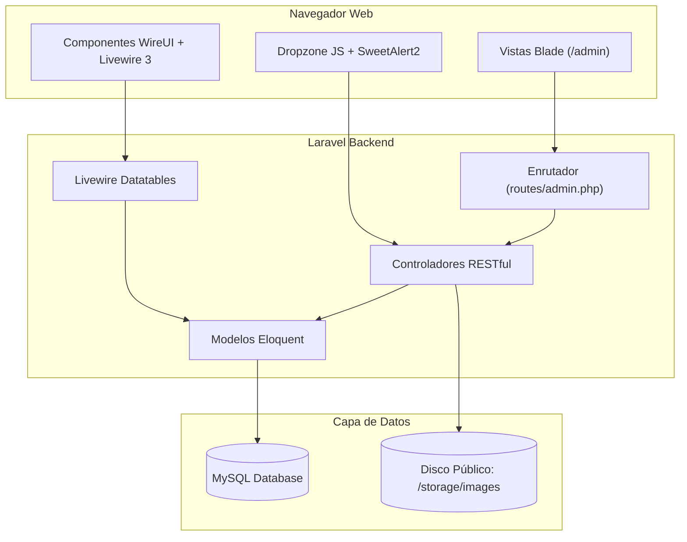
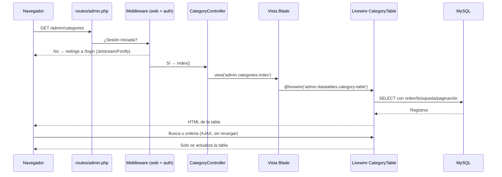

# 🏪 DevStore - Sistema de Gestión de Inventario y Ventas

Sistema web para el control de inventarios, compras, cotizaciones y ventas desarrollado con **Laravel 13**, **Livewire 3**, **Tailwind CSS**, **WireUI** y **MySQL**.

---

## 🗺️ Modelo de Base de Datos (ERD)

El sistema está diseñado bajo el siguiente diagrama entidad-relación que garantiza la trazabilidad comercial y el control de stock:


---

## 🏗️ Arquitectura del Sistema



---

## 📦 Módulos Implementados

| Módulo | Ruta | Funcionalidades Clave |
| :--- | :--- | :--- |
| **Categorías** | `/admin/categories` | Gestión del árbol de categorías de productos. Validación de unicidad y protección contra eliminación si contiene productos. |
| **Productos** | `/admin/products` | Catálogo completo con SKU, Código de barras, Precio y Categoría. Carga asíncrona de fotografías mediante **Dropzone JS** y previsualización en la tabla. |
| **Clientes** | `/admin/customers` | Registro de clientes con selección de tipo de documento (`identities`), validación de duplicados y protección de borrado si tienen cotizaciones o ventas. |
| **Proveedores** | `/admin/suppliers` | Registro de proveedores de mercancía con documento de identidad y validación referencial en órdenes de compra. |
| **Almacenes** | `/admin/warehouses` | Administración de sedes y almacenes físicos para la custodia del inventario. |
| **Órdenes de Compra** | `/admin/purchase-orders` | *(En desarrollo)* Listado y formulario de creación. Por ahora solo tiene las rutas `index` y `create`. |

---

<!-- cambio por IA: Sección explicativa del funcionamiento del proyecto y de sus dependencias -->
## 🧠 ¿Cómo funciona el proyecto?

### 1. Flujo de una petición (ejemplo: listar categorías)



### 2. Capas del proyecto

| Capa | Ubicación | Qué hace |
| :--- | :--- | :--- |
| **Rutas** | `routes/web.php`, `routes/admin.php` | `web.php` redirige `/` a `/admin`. `admin.php` se registra en `bootstrap/app.php` con prefijo `/admin`, nombre `admin.` y middleware `auth`. |
| **Controladores** | `app/Http/Controllers/Admin/` | CRUD RESTful con `Route::resource`: validan datos (`$request->validate`), guardan con Eloquent y devuelven mensajes con `session()->flash('swal', ...)`. |
| **Modelos** | `app/Models/` | Eloquent: relaciones entre productos, categorías, inventario, compras, ventas, etc. (incluye relaciones polimórficas con `productables` e `images`). |
| **Tablas Livewire** | `app/Livewire/Admin/Datatables/` | Tablas con búsqueda, orden y paginación sin recargar la página. |
| **Vistas** | `resources/views/admin/` | Usan el componente `<x-admin-layout>` (layout `layouts/admin.blade.php`) que incluye navbar, sidebar y breadcrumb. |
| **Migraciones y Seeders** | `database/` | Crean las tablas y llenan datos de prueba (usuario admin, clientes, proveedores, productos). |

### 3. Paquetes de PHP (`composer.json`)

#### Producción (`require`)

| Paquete | ¿Para qué se usa en este proyecto? |
| :--- | :--- |
| **laravel/framework** | El núcleo: rutas, controladores, Eloquent, Blade, validación, sesiones. |
| **laravel/jetstream** | Kit de autenticación ya hecho: **login, registro, recuperar contraseña, perfil, 2FA y cerrar sesiones**. Vistas en `resources/views/auth` y `resources/views/profile`; acciones en `app/Actions/Jetstream`. Configurado con el *stack* Livewire y fotos de perfil (`config/jetstream.php`). |
| **laravel/fortify** *(viene con Jetstream)* | Es el "motor" del backend de autenticación que usa Jetstream. Lo personalizas en `app/Actions/Fortify` (ej. `CreateNewUser.php` valida el registro). |
| **laravel/sanctum** | Autenticación por sesión/tokens. Jetstream lo usa como *guard* (`'guard' => 'sanctum'`) y protege `/dashboard` con `auth:sanctum`. También permitiría tokens para una API futura. |
| **livewire/livewire** | Permite crear componentes **interactivos escritos en PHP** (sin escribir JavaScript). Se usa en las tablas del admin y en los formularios de perfil de Jetstream. Incluye **Alpine.js** internamente. |
| **rappasoft/laravel-livewire-tables** | Construye las tablas de datos (`CategoryTable`, `ProductTable`, `CustomerTable`, `SupplierTable`, `WarehouseTable`). Solo defines columnas con `Column::make()` y él agrega búsqueda, orden y paginación. |
| **wireui/wireui** | Librería de componentes visuales para Blade/Livewire: `<x-wire-button>`, `<x-wire-input>`, `<x-wire-card>`, `<x-wire-textarea>`… Se carga con `<wireui:scripts />` en el layout admin. |
| **laravel-lang/common** | Traducciones al español de mensajes de Laravel (validación, auth, paginación). Por eso existe la carpeta `lang/es` y `APP_LOCALE=es` en `.env`. |
| **laravel/tinker** | Consola interactiva para ejecutar PHP dentro del proyecto. **No se usa en el código**, es una herramienta para ti. Ejemplo: `php artisan tinker` → `App\Models\Product::count()`. Útil para probar consultas y relaciones. |

#### Desarrollo (`require-dev`)

| Paquete | ¿Para qué sirve? |
| :--- | :--- |
| **fakerphp/faker** | Genera datos falsos (nombres, emails, precios) en las *factories*. Lo usa el seeder para crear 50 clientes, 50 proveedores y 100 productos. |
| **phpunit/phpunit** | Ejecuta pruebas automatizadas (`php artisan test`). |
| **mockery/mockery** | Crea objetos simulados (*mocks*) dentro de las pruebas. |
| **nunomaduro/collision** | Muestra errores bonitos y legibles en la consola. |
| **laravel/pint** | Formatea el código PHP según el estándar (`./vendor/bin/pint`). |
| **laravel/pail** | Muestra los logs en tiempo real en la terminal (`php artisan pail`), en vez de abrir `storage/logs/laravel.log`. |
| **laravel/pao** | Herramienta de desarrollo incluida en el *skeleton* de Laravel 13; no se usa directamente en el código del proyecto. |

### 4. Paquetes de JavaScript / Frontend

| Herramienta | Cómo se carga | ¿Para qué se usa? |
| :--- | :--- | :--- |
| **Vite** + **laravel-vite-plugin** | `npm run dev` / `@vite(...)` | Compila `resources/css/app.css` y `resources/js/app.js` y recarga el navegador al guardar. |
| **Tailwind CSS** (+ forms, typography) | Vite | Estilos con clases utilitarias (`flex`, `p-4`, `bg-gray-50`…). |
| **Flowbite** | npm + CDN | Comportamiento JS del sidebar (desplegables con `data-collapse-toggle`) y componentes UI. |
| **Alpine.js** | Incluido en Livewire 3 | Interactividad ligera en el navegador (lo usa WireUI). No se carga aparte para evitar doble inicialización. |
| **SweetAlert2** | CDN en `layouts/admin.blade.php` | Alertas de éxito/error. El controlador hace `session()->flash('swal', [...])` y el layout ejecuta `Swal.fire(...)`. |
| **Dropzone JS** | CDN en `products/edit.blade.php` | Subir imágenes arrastrando; envía a `admin.products.dropzone` y se guardan en `storage/app/public/images`. |
| **Font Awesome** | CDN | Íconos del menú (`fa-solid fa-box`, etc.). |
| **concurrently** / **@laravel/multiplex** | npm | Ejecutar varios procesos a la vez (servidor, Vite, logs) con `composer dev`. |

### 5. Autenticación en resumen

1. El usuario entra a `/admin` → el middleware `auth` revisa la sesión.
2. Si no hay sesión → Jetstream muestra `/login`.
3. Fortify valida credenciales y crea la sesión (con protección CSRF y contraseñas cifradas con bcrypt).
4. Ya autenticado, accede a todas las rutas de `routes/admin.php`.

---

## 🛠️ Requisitos del Entorno

* **PHP:** ^8.3
* **Gestor de paquetes:** Composer 2.x
* **Node.js & NPM:** Node.js 18+ / NPM 10+
* **Servidor Local:** WAMP64 (o Laragon / XAMPP)
* **Base de Datos:** MySQL 8.0+

---

## ⚙️ Instalación y Configuración Local

### 1. Clonar el repositorio y entrar al directorio
```bash
cd c:/wamp64/www/laravel/inventatirio
```

### 2. Instalar dependencias de PHP y JavaScript
```bash
composer install
npm install
```

### 3. Configurar el archivo de entorno (.env)
Asegúrate de que las credenciales de base de datos apunten a tu servidor MySQL:
```env
APP_NAME="DevStore Inventario"
APP_URL=http://inventario.test

DB_CONNECTION=mysql
DB_HOST=127.0.0.1
DB_PORT=3306
DB_DATABASE=inventario
DB_USERNAME=root
DB_PASSWORD=
```

### 4. Generar enlace simbólico de almacenamiento para imágenes
```bash
php artisan storage:link
```

### 5. Ejecutar migraciones y seeders de prueba
```bash
php artisan migrate:fresh --seed
```

Este comando poblará automáticamente:
* **Usuario Administrador:** `juan@correo.com` / contraseña: `12345678`
* Tipos de documento oficiales (`identities`)
* Categorías iniciales
* Almacén principal
* 50 Clientes ficticios (Faker)
* 50 Proveedores ficticios (Faker)
* 100 Productos con precios y categorías (Faker)

### 6. Iniciar el entorno de desarrollo
En una terminal:
```bash
npm run dev
```

Acceso al panel administrativo:  
👉 **`http://inventario.test/admin`** (o `http://localhost/laravel/inventatirio/public/admin`)

---

## 📖 Documentación Adicional del Proyecto

Para conocer a fondo los detalles técnicos y de desarrollo, consulta las siguientes guías:

* 📚 [**Guía de Arquitectura Laravel y Backend (GUIA_LARAVEL_INVENTARIO.md)**](file:///c:/wamp64/www/laravel/inventatirio/GUIA_LARAVEL_INVENTARIO.md): Explica los modelos, relaciones Eloquent, controladores, seguridad OWASP y el plan de desarrollo de compras y ventas.
* 🎨 [**Guía de Arquitectura Frontend (GUIA_FRONTEND_INVENTARIO.md)**](file:///c:/wamp64/www/laravel/inventatirio/GUIA_FRONTEND_INVENTARIO.md): Explica los componentes WireUI, la reactividad de Livewire 3, integración con Dropzone JS y modales con SweetAlert2.